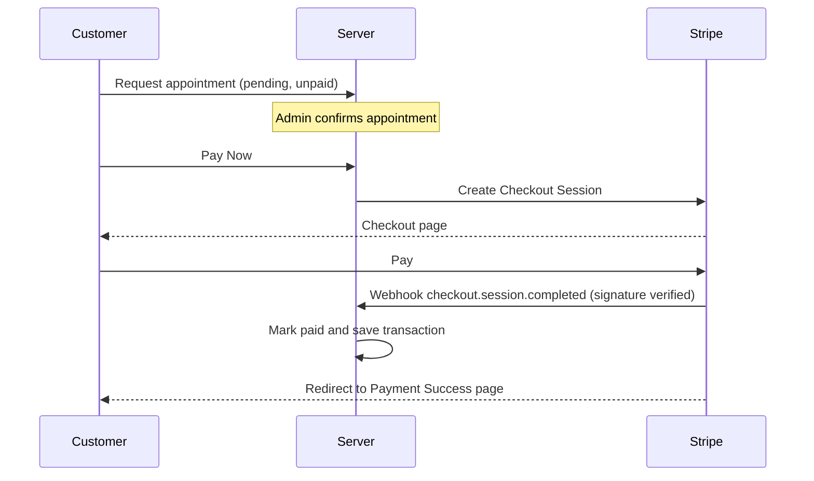

<div align="center">

<h1>✂️ SalonBook API</h1>

<p><b>Secure REST API for the SalonBook salon appointment booking platform</b></p>

<p>
  
  
  
  
  
</p>

<p>
  <a href="https://salonbook-mocha.vercel.app/"><b>🌐 Live Website</b></a> &nbsp;•&nbsp;
  <a href="https://salonbook-api-three.vercel.app/"><b>⚙️ Live API</b></a> &nbsp;•&nbsp;
  <a href="https://github.com/Kowshikkantidasbd/SalonBook"><b>💻 Client Repo</b></a> &nbsp;•&nbsp;
  <a href="https://github.com/Kowshikkantidasbd/SalonBook-api"><b>🗄 Server Repo</b></a>
</p>

</div>

---

## 📖 Description

SalonBook lets customers browse salon services, request appointments and pay for confirmed ones through Stripe. The salon admin manages services, appointments, customers and payment transactions.

This repository is the **server**. The [client app](https://github.com/Kowshikkantidasbd/SalonBook) is a separate repository.

> **Quick links:** [Features](#-important-features) · [Tech Stack](#-technology-stack) · [Payment Flow](#-payment-flow) · [Database](#-database-collections) · [API](#-api-overview) · [Run Locally](#-how-to-run-locally) · [Environment](#-required-environment-variables) · [Deployment](#-deployment-vercel)

---

## ✨ Important Features

| | Feature | Details |
|:-:|---|---|
| 🔐 | **Authentication** | Better Auth (email/password and Google) at `/api/auth/*` |
| 🛡 | **Authorization** | Role (`admin`, `customer`) verified **on the server** for every protected route |
| 🚫 | **Blocked users** | Blocked users cannot use protected features |
| 💇 | **Services** | Add, update, delete, activate/deactivate (admin only), image upload through ImgBB |
| 🔎 | **Browsing** | Public list with search by name, category filter and price sorting |
| 📅 | **Appointments** | Predefined time slots, duplicate slot prevention, inactive services blocked |
| ❌ | **Cancellation** | Customers cancel only their own pending appointments; admin cancels pending or confirmed |
| 💳 | **Payments** | Stripe Checkout for confirmed appointments only |
| ✅ | **Payment status** | Set to `paid` **only by a verified Stripe webhook**, never by the client or admin |
| 👤 | **Profile** | Update name, image and phone. `role` and `isBlocked` cannot be changed |
| 📊 | **Dashboards** | Customer and admin statistics, users and transactions |
| ⚠️ | **Errors** | Clear JSON messages with proper HTTP status codes |

## 🛠 Technology Stack

| Layer | Technology |
|---|---|
| Runtime | Node.js |
| Framework | Express.js |
| Database | MongoDB with Mongoose |
| Auth | Better Auth, JWT |
| Payments | Stripe |
| Images | ImgBB |
| Hosting | Vercel (serverless, `vercel.json`) |

## 💳 Payment Flow



## 🗄 Database Collections

| Collection | Main fields |
|---|---|
| `users` (Better Auth) | name, email, image, role, isBlocked, phone |
| `services` | serviceName, category, description, price, duration, image, status, createdAt |
| `appointments` | serviceId, customerId, appointmentDate, timeSlot, message, servicePrice, paymentStatus, status, createdAt |
| `transactions` | appointmentId, customerId, amount, currency, stripeSessionId, status, createdAt |

| Field | Allowed values |
|---|---|
| Appointment status | `pending` · `confirmed` · `cancelled` |
| Payment status | `unpaid` · `paid` |
| Transaction status | `paid` · `failed` |

## 🔌 API Overview

| Access | Endpoints |
|---|---|
| 🌍 Public | `GET /` · `GET /api/health` · `GET /api/services` · `GET /api/services/:id` |
| 🔑 Auth | `/api/auth/*` (Better Auth) |
| 🧑 Customer | `POST /api/appointments` · `GET /api/appointments/slots` · `GET /api/appointments/my` · `GET /api/customer/stats` · `POST /api/payments/create-checkout-session` · cancel own pending appointment · update own profile |
| 🛠 Admin | `/api/admin/...` for stats, services, appointments, users (block/unblock) and transactions |
| 💳 Stripe | `POST /api/webhooks/stripe` (raw body, signature verified) |

---

## 📦 Installation

```bash
git clone https://github.com/Kowshikkantidasbd/SalonBook-api.git
cd SalonBook-api
npm install
```

## ▶️ How to Run Locally

```bash
cp .env.example .env     # then fill in the values
npm start                # starts the server on http://localhost:5000
npm test                 # runs the checks
```

Open `http://localhost:5000/api/health`. It should show `"database": "mongodb"`.

<details>
<summary><b>Test Stripe webhooks locally</b></summary>

```bash
stripe listen --forward-to localhost:5000/api/webhooks/stripe
```

Copy the printed `whsec_...` value into `STRIPE_WEBHOOK_SECRET`.

</details>

## 🔐 Required Environment Variables

Names only. Never commit `.env` files or real secret values.

| Group | Variables |
|---|---|
| Server | `NODE_ENV`, `PORT` |
| Database | `MONGODB_URI` |
| Auth | `JWT_SECRET`, `BETTER_AUTH_SECRET`, `BETTER_AUTH_URL` |
| URLs | `BACKEND_PUBLIC_URL`, `FRONTEND_URL` |
| Admin | `ADMIN_EMAIL`, `ADMIN_PASSWORD`, `SEED_DEMO_DATA` |
| Google OAuth | `GOOGLE_CLIENT_ID`, `GOOGLE_CLIENT_SECRET` |
| Stripe | `STRIPE_SECRET_KEY`, `STRIPE_WEBHOOK_SECRET` |
| ImgBB | `IMGBB_API_KEY` |

## 🚀 Deployment (Vercel)

1. Add all variables above in Vercel project settings (`NODE_ENV=production`, `SEED_DEMO_DATA=false`).
2. In MongoDB Atlas, allow network access from `0.0.0.0/0` (Vercel IPs are not fixed).
3. In the Stripe dashboard add the webhook endpoint `https://salonbook-api-three.vercel.app/api/webhooks/stripe` for `checkout.session.completed` and put its signing secret in `STRIPE_WEBHOOK_SECRET`.
4. Redeploy after any environment variable change.
5. Open `/api/health` and confirm `mongoConnected` is `true`.

<details>
<summary><b>🩺 Troubleshooting</b></summary>

| Problem | Check |
|---|---|
| `503 Server is not configured correctly` | Read the `detail` text. Usually `MONGODB_URI`, Atlas network access or a missing secret |
| Payment stays `unpaid` | Webhook endpoint and `STRIPE_WEBHOOK_SECRET` must match the Stripe dashboard |
| Image upload fails | `IMGBB_API_KEY` missing or invalid |
| Login fails after deploy | Redeploy both projects after changing environment variables |

</details>

## 👤 Admin Access

Admin accounts cannot be created through public sign-up. Admin access is assigned securely from `ADMIN_EMAIL` and `ADMIN_PASSWORD`. Evaluation credentials are shared separately and are never stored in this repository.

---

<div align="center">
  Made with ❤️ for SalonBook
</div>